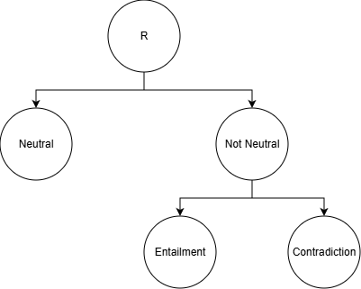
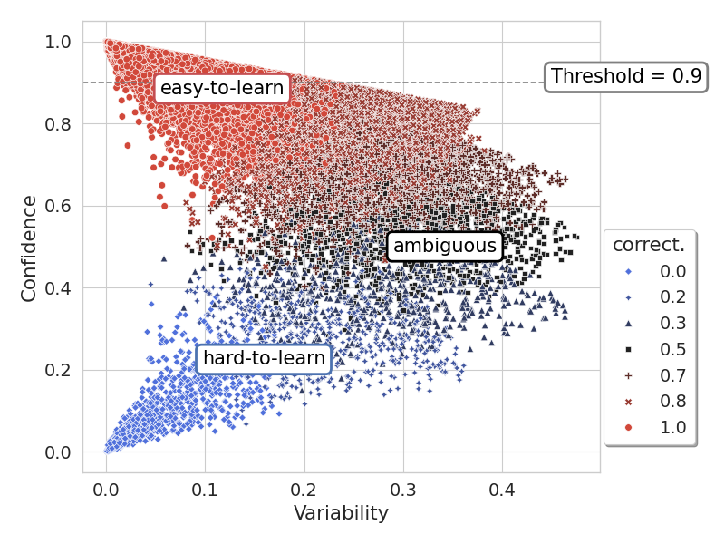

# Mitigating Dataset Artifacts in SNLI

In this project, we study dataset artifacts in the SNLI dataset and evaluate whether
a lightweight mitigation approach can improve robustness beyond standard test accuracy.

We finetune an ELECTRA-small baseline model on SNLI and compare it with a two-stage
hierarchical classifier combined with focus learning on hard-to-learn examples.
The hierarchical classifier first separates **Neutral** from **Not Neutral**,
then classifies **Not Neutral** examples as **Entailment** or **Contradiction**.

We construct a 30-example contrast set from SNLI test examples by applying small but
meaningful perturbations to premises and hypotheses. This contrast set is used to probe
whether the model relies on spurious dataset artifacts.
The proposed approach improves contrast-set accuracy from **46.67%** to **56.67%**,
while maintaining comparable performance on the full SNLI test set.

The repository contains the code and report for the project.
The final report could be found at [report/main.pdf](./report/main.pdf).

Here we provide the figures illustrating the proposed method:

### Hierarchical classification structure

### SNLI data map for focus learning

## Repository Usage

Please refer to [README.md](./src/README.md) inside `src` folder.

## Course Information

Course Title: Natural Language Processing

Course code: DSC 388

Abstract: This course focuses on modern natural language processing using statistical methods and deep learning. Problems addressed include syntactic and semantic analysis of text as well as applications such as sentiment analysis, question answering, and machine translation. Machine learning concepts covered include binary and multiclass classification, sequence tagging, feedforward, recurrent, and self-attentive neural networks, and pre-training / transfer learning.

Instructor: [Prof. Greg Durrett](https://gregdurrett.github.io/)

## Author

[@wyhwong](https://github.com/wyhwong)
